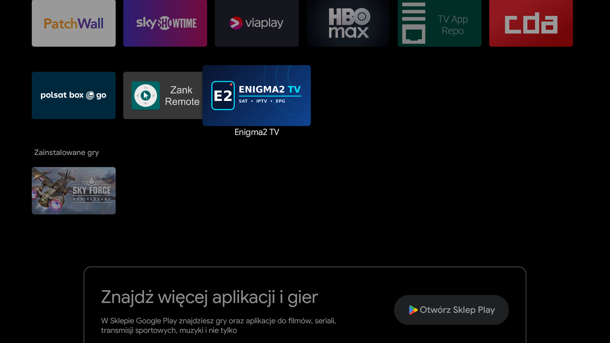
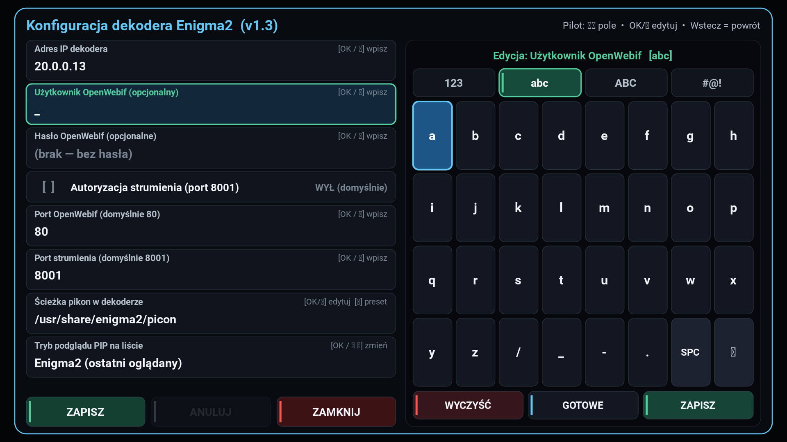
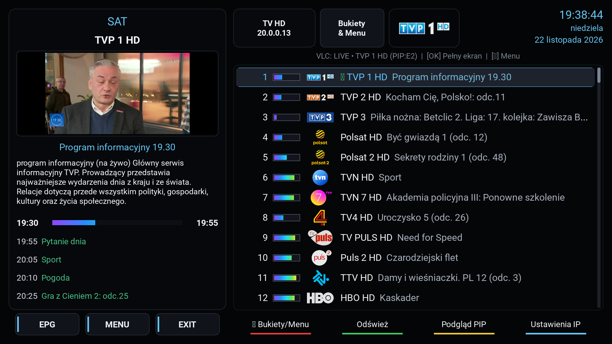
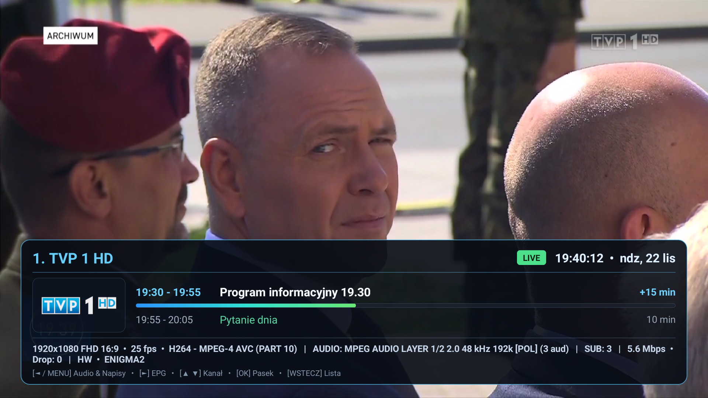
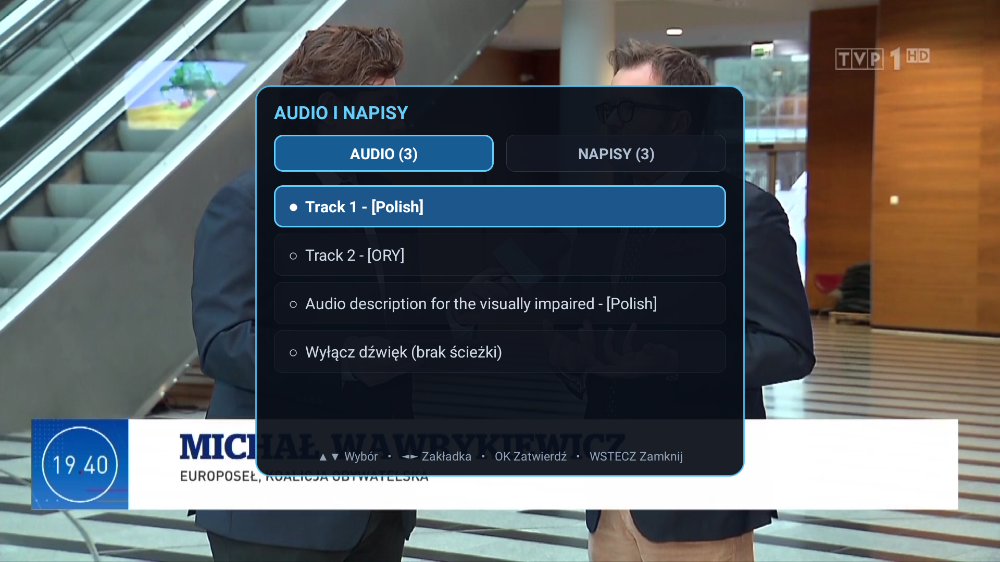
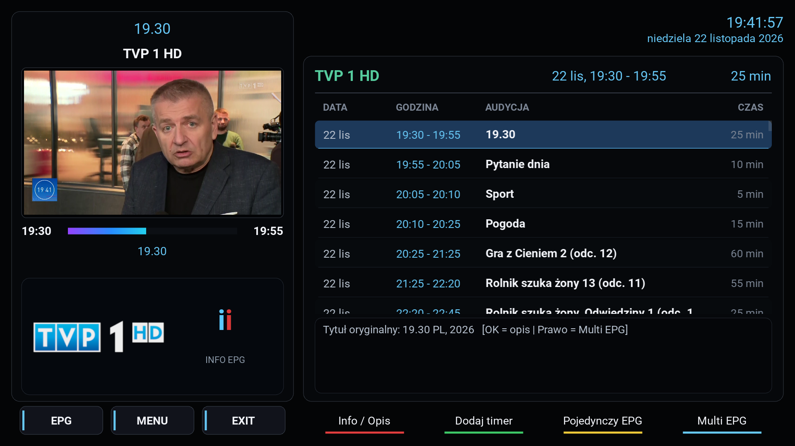
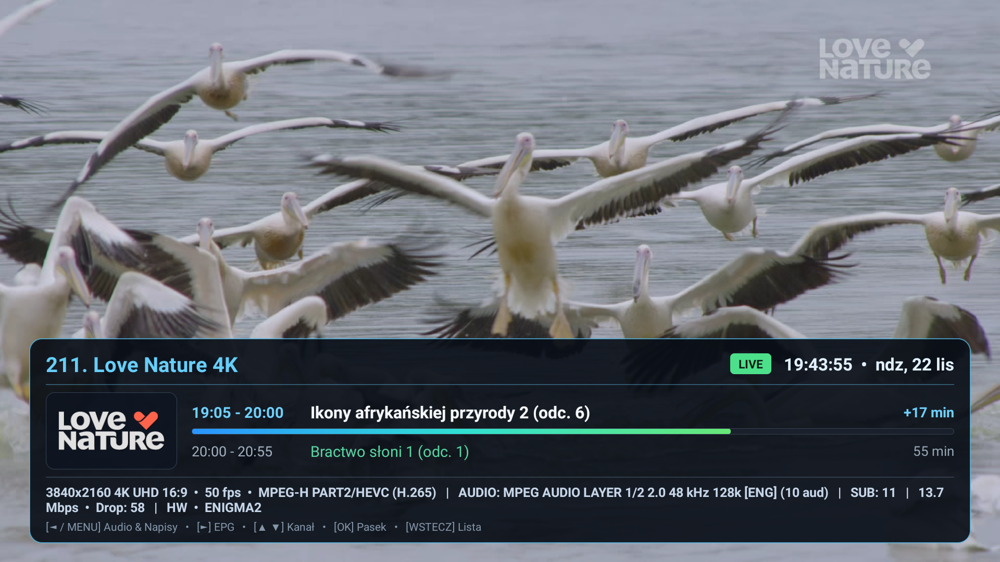

# Enigma2 TV

### Lekki klient dekoderów Enigma2 dla Android TV z natywnym silnikiem LibVLC

[](https://github.com/Payti/EnigmaTVApp/actions/workflows/build-apk.yml)
[](https://github.com/Payti/EnigmaTVApp/releases)
[](https://github.com/Payti/EnigmaTVApp/commits/main)
[](LICENSE)

Aplikacja **Enigma2 TV** zaprojektowana typowo pod **Android TV** i pełną obsługę zwykłym pilotem. Łączy się bezpośrednio z dekoderem w sieci lokalnej przez **OpenWebif API** (domyślnie port `80` + strumień na porcie `8001`), bez transkodowania po stronie tunera. Odtwarzanie realizuje natywny silnik **LibVLC 3.6.0** ze sprzętowym dekodowaniem (H.264 / H.265 HEVC / MPEG-2), obsługując kanały **SD / HD / Full HD / 4K UHD** oraz streamy IPTV z bukietów.

Przetestowano na: **Xiaomi Mi Box 4K**, **Philips 65PUS8536 (Android TV 11)**.

---

## Zrzuty ekranu

| Aplikacja w Android TV | Ustawienia IP, logowania OpenWebif, pikon, PIP i klawiatura TV |
| :---: | :---: |
|  |  |

| Lista kanałów z podglądem PIP | Pełny ekran z Infobarem Enigma2 (`OK`) |
| :---: | :---: |
|  |  |

| Wybór ścieżki Audio i Napisów | Przewodnik EPG (Pojedynczy / Multi EPG) |
| :---: | :---: |
|  |  |

| Odtwarzanie kanału 4K UHD (H.265/HEVC) |
| :---: |
|  |

---

## Co nowego w v1.3

- **Natychmiastowe okno EPG z animacją ładowania** — cały interfejs EPG pojawia się od razu bez czarnego ekranu, wyświetlając obracający się wskaźnik i komunikat `Pobieram EPG z dekodera ...` na czas pobierania danych z dekodera oraz porcjowanego renderowania wierszy.
- **Logowanie do OpenWebif (HTTP Basic Auth)** — nowe pola `Użytkownik OpenWebif` i `Hasło OpenWebif` (gdy puste, aplikacja łączy się bez uwierzytelniania) oraz opcjonalny checkbox **Autoryzacja strumienia (port 8001)** dopisujący dane logowania do adresu wideo dopiero po jego włączeniu.
- **Przełączana klawiatura ekranowa TV** — tryby **`123`**, **`abc`**, **`ABC`** oraz **`#@!`** (ze znakami `/`, `_`, `-`, `.` i spacją) obsługiwane pilotem dla pól IP, użytkownika, hasła i własnej ścieżki pikon.
- **Rozbudowana obsługa pilota** — podwójne szybkie **`◄` (Lewo)** na liście kanałów i w EPG przenosi fokus na przyciski **`EPG` / `MENU` / `EXIT`**; oprogramowano wszystkie 4 kolorowe przyciski na liście kanałów (**Czerwony** – Bukiety/Menu, **Zielony** – Odśwież, **Żółty** – Podgląd PIP, **Niebieski** – Ustawienia IP).
- **Poprawne dekodowanie znaków w EPG i Infobarze** — dekodowanie encji HTML (`&quot;`, `&amp;`, `&#39;`, `&nbsp;` itd.), znaczników `<br>` oraz znaków sterujących DVB w tytułach, opisach i nazwach kanałów.

<details>
<summary><strong>Historia wcześniejszych zmian (v1.0 – v1.2)</strong></summary>

### v1.2
- **Dwa tryby podglądu PIP (PIG) na liście kanałów** — dodano wybór między trybem *Enigma2 (ostatni oglądany)* (chodzenie po liście i zmiana bukietów nie przerywa podglądu) oraz *Auto (podąża za kursorem)* (automatyczny podgląd po ok. 1 s postoju na kanale).
- **Kolorowe menu bukietów i opcji pod `◄`** — szybkie przełączanie bukietów, zmiana trybu PIP, wywołanie EPG, odświeżenie listy, wejście w ustawienia i zamknięcie aplikacji z jednego panelu bez zasłaniania podglądu PIP.
- **Dedykowany baner Android TV (Leanback)** oraz szybkie zamykanie aplikacji przez podwójne naciśnięcie `Wstecz` (`2× Wstecz`).
- **Zapamiętywanie ostatnio oglądanego kanału i bukietu** pomiędzy uruchomieniami aplikacji.

### v1.1
- **Infobar w stylu Enigma2 (pod `OK` na pełnym ekranie)** — pikona kanału, 2 wiersze EPG (aktualna audycja z paskiem postępu i czasem do końca + następna), zegar z datą oraz pełna diagnostyka strumienia na żywo (rozdzielczość `4K UHD` / `FHD` / `HD` / `SD` z korektą DVB `1088→1080`, proporcje, FPS, kodek wideo, ścieżka audio, liczba ścieżek napisów, bitrate Mbps, zgubione klatki).
- **Natywna nakładka wyboru Audio i Napisów** na pełnym ekranie (obsługa napisów DVB Sub i Teletext oraz możliwość ich wyłączenia).
- **Pełny przewodnik EPG** — Pojedynczy EPG, Multi EPG dla całego bukietu, szczegółowy opis audycji z wyszukiwaniem podobnych emisji oraz zdalne dodawanie timerów nagrywania na dekoderze.
- **Asynchroniczne pobieranie i lokalny cache pikon** z dekodera (domyślnie `/usr/share/enigma2/picon`).

### v1.0
- Pierwsze wydanie klienta **Enigma2 TV** dla Android TV (Kivy/Python + natywny **LibVLC 3.6.0** ze sprzętowym dekodowaniem na `TextureView`).
- Integracja z **OpenWebif API** (pobieranie bukietów i listy kanałów z portu `80`, bezpośredni odczyt strumienia z portu `8001` oraz obsługa kanałów IPTV w bukietach).
- Lista kanałów z wbudowanym podglądem PIP, pełnoekranowe odtwarzanie H.264 / H.265 HEVC / MPEG-2 (w tym 4K UHD) oraz ekran konfiguracji IP z klawiaturą numeryczną obsługiwaną pilotem.

</details>

---

## Najważniejsze funkcje

- **Dwa tryby podglądu PIP (PIG) na liście kanałów:**
  - *Enigma2 (ostatni oglądany)* — po uruchomieniu odtwarza ostatni oglądany kanał, a przeglądanie listy i bukietów nie przerywa podglądu.
  - *Auto (podąża za kursorem)* — automatycznie uruchamia podgląd po ok. 1 s postoju na wybranym kanale.
- **Infobar w stylu Enigma2 (pod `OK` na pełnym ekranie)** — pikona kanału, aktualna i następna audycja EPG z paskiem postępu i czasem do końca, zegar z datą oraz diagnostyka strumienia na żywo: rozdzielczość (`4K UHD` / `FHD` / `HD` / `SD`), proporcje, FPS, kodek wideo, aktywna ścieżka audio, liczba ścieżek napisów, bitrate (Mbps) oraz zgubione klatki.
- **Wybór ścieżki Audio i Napisów z pilota** — natywna nakładka na pełnym ekranie z obsługą napisów DVB Sub i Teletext oraz możliwością ich wyłączenia.
- **Pełny przewodnik EPG** — Pojedynczy EPG, Multi EPG dla całego bukietu, szczegółowy opis z wyszukiwaniem podobnych audycji oraz zdalne dodawanie timerów nagrywania na dekoderze.
- **Dopasowanie do Android TV** — baner Leanback, automatyczne pobieranie i cache pikon z dekodera (domyślnie `/usr/share/enigma2/picon`), obsługa HTTP Basic Auth, kolorowe menu bukietów i zamykanie przez `2× Wstecz`.

---

## Sterowanie pilotem

| Ekran | Klawisze pilota | Akcja |
|---|---|---|
| **Lista kanałów** | `▲` / `▼` | Zmiana kanału |
| | `►` / `CH-` / `CH+` | Przewijanie stroną |
| | `OK` | Odtwarzanie na pełnym ekranie |
| | `◄` (pojedyncze) / **Czerwony** | Menu bukietów, zmiana trybu PIP i opcje |
| | **`2× ◄` (szybko)** | Fokus na dolny pasek **`EPG` / `MENU` / `EXIT`** |
| | **Zielony** | Odśwież listę bukietów z dekodera |
| | **Żółty** | Podgląd PIP wybranego kanału |
| | **Niebieski** / `MENU` | Ustawienia IP, logowania, pikon i PIP |
| | `2× Wstecz` | Zamknięcie aplikacji |
| **Pełny ekran** | `OK` | Pokaż / ukryj Infobar |
| | `▲` / `▼` | Przełączanie kanałów |
| | `◄` / `MENU` / `AUDIO` / `SUB` | Wybór ścieżki Audio i Napisów |
| | `►` / `EPG` | Otwórz przewodnik EPG |
| | `Wstecz` | Powrót do listy kanałów |
| **Przewodnik EPG** | `▲` / `▼` | Nawigacja po audycjach / kanałach |
| | `◄` / `►` | Przełączanie trybu (Pojedynczy / Multi / Info) |
| | **`2× ◄` (szybko)** | Fokus na przyciski **`EPG` / `MENU` / `EXIT`** |
| | `OK` | Opis audycji lub przełączenie kanału (w Multi EPG) |
| | **Czerwony / Zielony / Żółty / Niebieski** | Info / Dodaj timer / Pojedynczy EPG / Multi EPG |
| | `Wstecz` | Powrót |

---

## Instalacja

Gotowe paczki `.apk` są dostępne w zakładce [**Releases**](https://github.com/Payti/EnigmaTVApp/releases).

### Instalacja przez ADB (zalecane na Android TV 11+, np. Philips 65PUS8536)

> [!NOTE]
> Telewizory z Android TV 11+ często blokują instalację plików `.apk` bezpośrednio z pendrive'a. Instalacja po sieci przez **ADB** omija to ograniczenie, a flaga `-r` zachowuje zapisaną konfigurację IP i cache pikon podczas aktualizacji.

#### Krok 1: Włączenie debugowania na telewizorze / przystawce Android TV

1. Wejdź w **Ustawienia Androida → Ustawienia urządzenia → Informacje → Kompilacja** i naciśnij **OK** 7 razy, aż pojawi się komunikat o włączeniu trybu programisty.
2. Wróć do **Ustawienia urządzenia → Opcje programisty** i włącz **Debugowanie USB** (jeśli jest dostępna opcja *Weryfikuj aplikacje przez USB*, wyłącz ją).
3. Sprawdź adres IP telewizora w ustawieniach sieci (np. `192.168.1.50`).

#### Krok 2a: Instalacja z komputera Linux (Ubuntu)

```bash
sudo apt update && sudo apt install -y adb
adb connect <IP_TELEWIZORA>:5555
```

Zaakceptuj na ekranie telewizora komunikat **Zezwolić na debugowanie USB?** (*Zawsze zezwalaj z tego komputera → OK*), a następnie zainstaluj plik APK:

```bash
adb devices
adb -s <IP_TELEWIZORA>:5555 install -r enigma2tv-1.3-armeabi-v7a_arm64-v8a-debug.apk
adb disconnect <IP_TELEWIZORA>:5555
```

#### Krok 2b: Instalacja z komputera Windows (ADB / Platform-Tools)

1. Pobierz oficjalną paczkę **SDK Platform-Tools for Windows** ze strony Google: [platform-tools-latest-windows.zip](https://dl.google.com/android/repository/platform-tools-latest-windows.zip).
2. Rozpakuj archiwum do prostego katalogu, np. `C:\adb` (lub `C:\platform-tools`), i skopiuj do tego samego folderu pobrany plik `enigma2tv-1.3-armeabi-v7a_arm64-v8a-debug.apk`.
3. Otwórz **Wiersz poleceń (`cmd`)** w tym folderze (w pasku adresu Eksploratora Windows wpisz `cmd` i naciśnij `Enter`).
4. Połącz się z telewizorem:

```cmd
adb connect <IP_TELEWIZORA>:5555
```

5. Na ekranie telewizora zatwierdź monit **Zezwolić na debugowanie USB?** (*Zawsze zezwalaj z tego komputera → OK*).
6. Sprawdź połączenie i zainstaluj aplikację:

```cmd
adb devices
adb -s <IP_TELEWIZORA>:5555 install -r enigma2tv-1.3-armeabi-v7a_arm64-v8a-debug.apk
adb disconnect <IP_TELEWIZORA>:5555
```

*(W PowerShell zamiast `adb` użyj `.\adb`. Po pojawieniu się komunikatu `Success` aplikacja **Enigma2 TV** będzie gotowa do uruchomienia na ekranie Android TV.)*

---

## Budowanie ze źródeł

Projekt buduje się automatycznie w **GitHub Actions** (`.github/workflows/build-apk.yml`) po wypchnięciu tagu `v*` lub ręcznym uruchomieniu workflow, a także lokalnie przez Buildozer:

```bash
python3 -m py_compile main.py p4a_hook.py
buildozer -v android debug
```

---

## Licencja

Projekt udostępniany na licencji [MIT](LICENSE).

---

## Dotacja

Projekt **Enigma2 TV** jest darmowy i rozwijany hobbystycznie na licencji MIT. Jeśli aplikacja jest dla Ciebie przydatna i chcesz wesprzeć jej dalszy rozwój, możesz przekazać dobrowolną dotację przez PayPal — **zebrane środki zostaną przeznaczone na testy aplikacji na nowych urządzeniach z Android TV**.

[](https://www.paypal.com/paypalme/Payti)